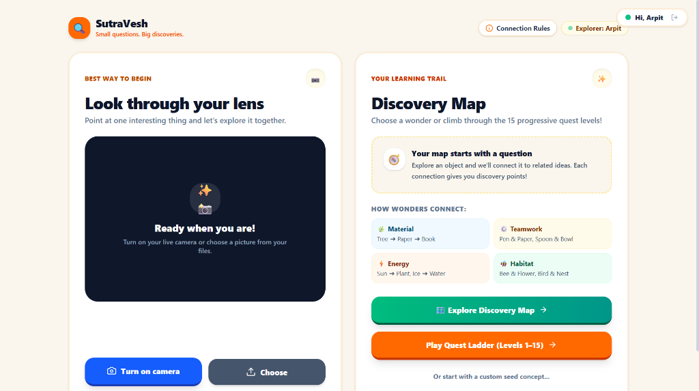
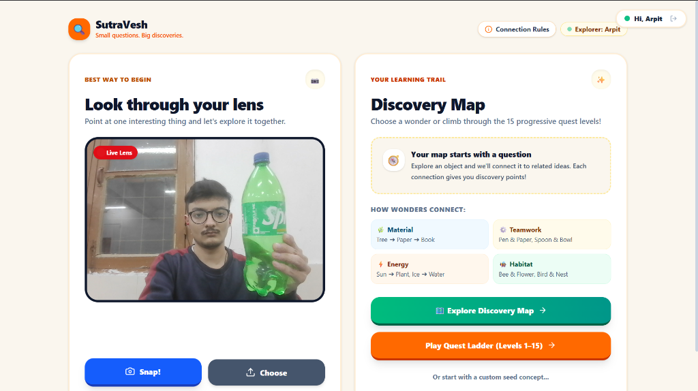
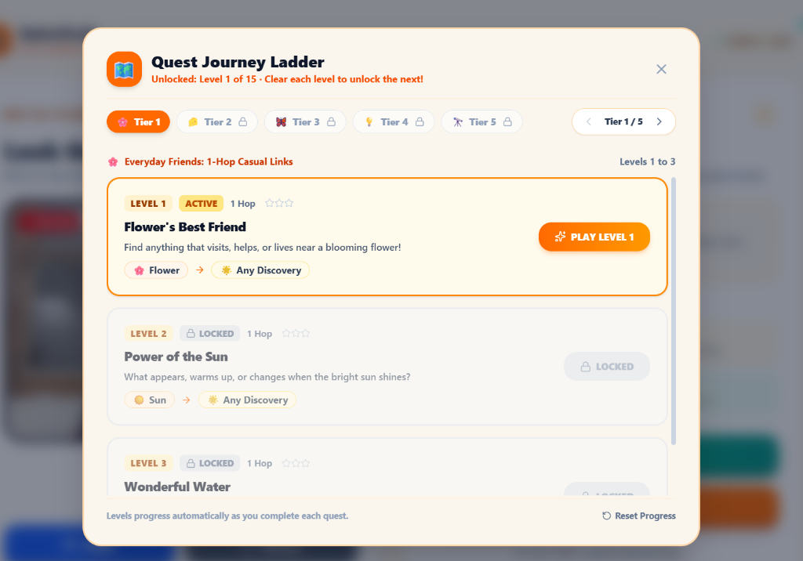
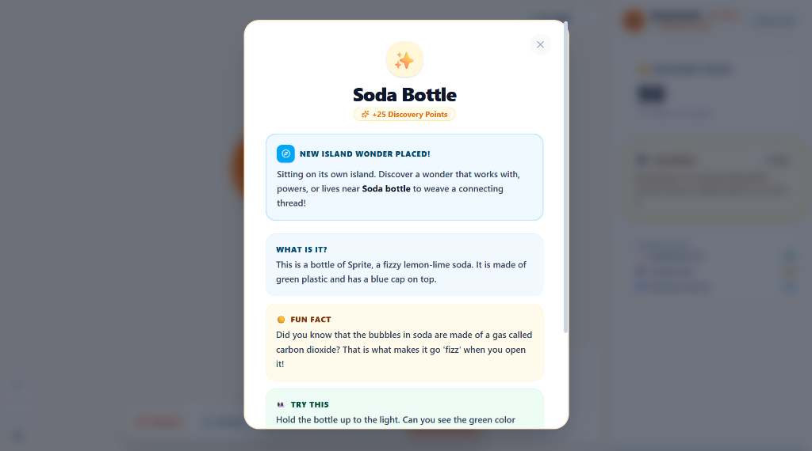
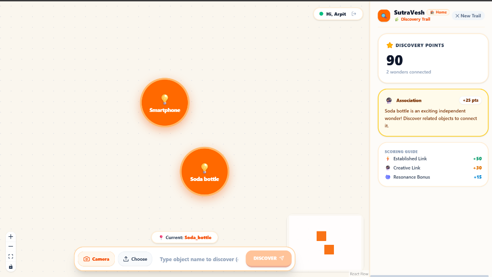
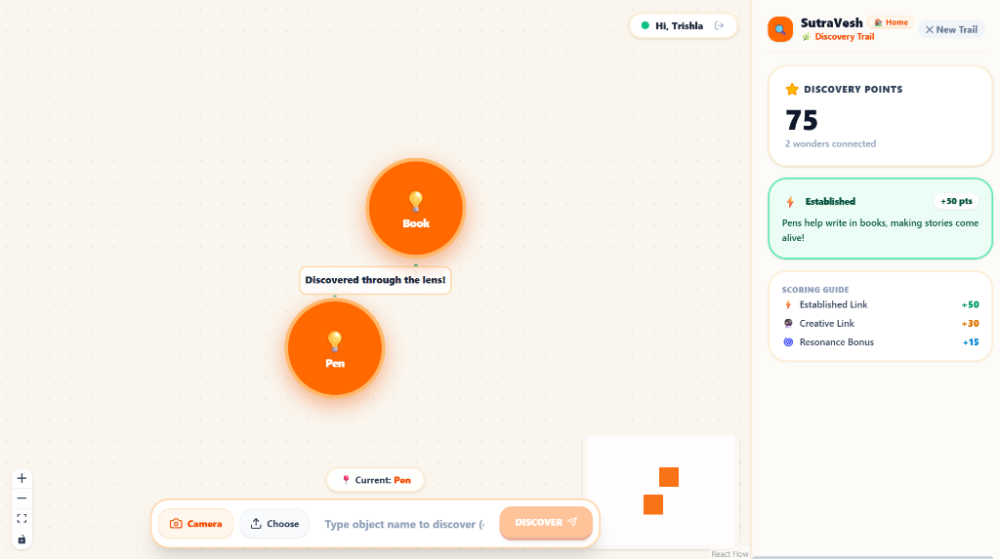
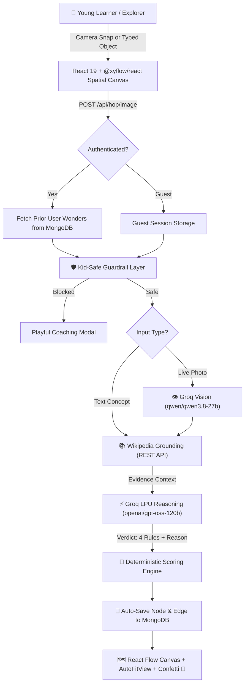

<div align="center">

# 🌟 SutraVesh (सूत्रवेष)
### *Agentic Discovery Engine for Curious Minds*

[](https://opensource.org/licenses/MIT)
[](https://www.python.org/)
[](https://fastapi.tiangolo.com/)
[](https://react.dev/)
[](https://groq.com/)
[](https://www.mongodb.com/)
[]()

**Hacktoberfest Hack Day Prayagraj × CC Club MNNIT (MLH Partnered)**  
**Track 1: Applied AI & Next-Gen Agents**

---

</div>

## 📖 What is SutraVesh?

**SutraVesh** (*Sanskrit*: 'सूत्र' = *Connecting Thread*, 'वेष' = *Form / Manifestation*) is an intelligent, kid-safe educational graph-reasoning agent. It empowers young learners to explore how everything in the universe connects—from a humble pencil or water bottle to trees, stars, solar panels, and ecosystems.

Unlike conventional chatbots that dump dense paragraphs of text, SutraVesh delivers an **interactive, tactile spatial discovery canvas**:
- 👁️ **Live Camera Lens**: Point your camera at any real-world object. The agent instantly recognizes what it is and crafts child-friendly discovery cards.
- 🗺️ **Multi-Object Discovery Map**: Objects don't disappear—they accumulate into a personal universe of wonders with relationship threads linking companion items.
- 🔗 **4 Scientific Connection Rules**: Bonds are grounded in real-world science (*Material & Ingredients*, *Purpose & Teamwork*, *Energy & Transformation*, *Habitat & Ecosystem*).
- 🏆 **15-Level Quest Journey Ladder**: Progressive challenge tiers taking children from 1-hop casual links to 4-hop cosmic chains.
- 🍃 **User-Scoped MongoDB Persistence**: Every captured wonder and relationship thread is stored directly in local MongoDB, keeping discovery maps specific to each user.
- 🛡️ **Child-Safe Guardrails**: Multi-tier profanity and hazard interception with playful, encouraging coaching.

---

## 📸 Screenshots & Working Demo

### 1. The Landing Hub
Dual-column interface featuring the in-page **Live Lens** camera on the left, and the **Discovery Map & Quest Ladder** on the right with user status and connection rules:


---

### 2. Live Lens Object Capture
Children point their device's camera at any physical item in their room (such as a green soda bottle, a book, or a pen):


---

### 3. 15-Level Quest Journey Ladder
Organized across 5 progressive tiers with star ratings, automatic level unlock progression, and replayability:


---

### 4. 3-Section Kid Discovery Card
When an object is captured, an educational card pops up featuring **What is it?**, **Fun Fact**, and **Try This!** along with discovery points:


---

### 5. Multi-Object Discovery Map
Both objects sit on the user's interactive spatial canvas (`Smartphone` + `Soda bottle`) with real-time discovery points, mini-map, zoom controls, and the bottom discovery input bar:


---

### 6. Connected Relationship Threads (e.g. Book ⟷ Pen)
When companion wonders are captured, SutraVesh dynamically weaves an animated connecting thread directly between them, with live evidence grounding and child-friendly educational explanations (`Pens help write in books, making stories come alive!` · Purpose & Teamwork · Established Link +50 pts):


---

## 🎯 How Wonders Connect: The 4 Connection Rules

SutraVesh evaluates every relationship using four core real-world connection principles:

| Rule Badge | Principle | Real-World Examples |
|---|---|---|
| **🌿 Material & Ingredients** | One object is made from, derived from, or contains the other. | `Tree ➔ Paper ➔ Book`<br>`Flour ➔ Bread`<br>`Sand ➔ Glass` |
| **⚙️ Purpose & Teamwork** | Objects or tools used together for a shared job or play. | `Pen & Paper`<br>`Spoon & Bowl`<br>`Lock & Key` |
| **⚡ Energy & Transformation** | One object powers, warms, feeds, grows, or transforms into the other. | `Sun ➔ Plant`<br>`Water ➔ Ice`<br>`Fire ➔ Smoke` |
| **🐝 Habitat & Ecosystem** | Organisms or objects that naturally live, grow, or exist together in the same environment. | `Bee & Flower`<br>`Bird & Nest`<br>`Fish & River` |

---

## 💯 Scoring Engine & Point Breakdown

SutraVesh features a transparent, positive-reinforcement scoring model designed to encourage curiosity:

| Action / Verdict | Mode | Points Awarded | Description |
|---|---|---|---|
| **Established Link** | Quest / World | **+50 pts** | Directly connects to a prior wonder via one of the 4 Connection Rules with Wikipedia evidence. |
| **Creative Association** | Quest / World | **+30 pts** | Connected through everyday similarity, shared habitat, or creative usage. |
| **Independent Wonder Island** | World Mode | **+25 pts** | Snapping a new object sitting on its own island before connecting to others. |
| **Resonance Bridge Bonus** | World Mode | **+15 pts / bridge** | Awarded when a newly discovered wonder connects to multiple disparate islands simultaneously. |
| **Speed Runner Bonus** | Quest Mode | **+20 pts** | Awarded when completing a quest goal efficiently ($\le 4$ hops). |
| **Safety Interception** | Both | **0 pts** | Non-educational or sensitive inputs are gently coached without penalty. |

### Badges Unlocked
- 🌟 **First Hop!**: Awarded on the very first successful connection.
- 🔗 **Chain Master**: Achieved by forming 3 consecutive established links.
- 🧠 **Einstein Mode**: Awarded for deep conceptual connections grounded in science.
- 🌉 **Bridge Builder**: Awarded when a resonance connection links two separate islands.
- 🗺️ **World Explorer**: Awarded for placing 5 or more unique wonders on the canvas.
- ⚡ **Speed Runner**: Reaching the quest target in fewer than 4 hops.

---

## 🪜 The 15-Level Quest Journey Ladder

The Quest Ladder is divided into 5 curated tiers that scale in cognitive complexity:

```text
Tier 1: Everyday Friends (Levels 1–3) · 1-Hop Casual Links
  ├── Level 1: Flower's Best Friend (Flower ➔ Any Companion)
  ├── Level 2: Power of the Sun (Sun ➔ Any Companion)
  └── Level 3: Wonderful Water (Water ➔ Any Companion)

Tier 2: Tool Pairs (Levels 4–6) · 2-Hop Purpose Links
  ├── Level 4: Pen to Library (Pen ➔ Book ➔ Library)
  ├── Level 5: Spoon to Feast (Spoon ➔ Bowl ➔ Soup)
  └── Level 6: Key to Castle (Key ➔ Lock ➔ Door)

Tier 3: Nature Trails (Levels 7–9) · 3-Hop Habitat & Life Links
  ├── Level 7: Acorn to Forest (Acorn ➔ Oak Tree ➔ Forest)
  ├── Level 8: Caterpillar to Sky (Caterpillar ➔ Cocoon ➔ Butterfly)
  └── Level 9: Raindrop to Ocean (Raindrop ➔ River ➔ Ocean)

Tier 4: Energy Bridges (Levels 10–12) · 3-Hop Energy & Transformation
  ├── Level 10: Sunlight to Solar Car (Sunlight ➔ Solar Panel ➔ Battery)
  ├── Level 11: Wind to Lightbulb (Wind ➔ Turbine ➔ Electricity)
  └── Level 12: Cocoa to Chocolate Bar (Cocoa Bean ➔ Roast ➔ Chocolate)

Tier 5: Grand Cosmic Chains (Levels 13–15) · 4-Hop Ecosystem Chains
  ├── Level 13: Stardust to Smartphone (Supernova ➔ Silicon ➔ Microchip ➔ Smartphone)
  ├── Level 14: Dinosaur to Plastic Toy (Plankton ➔ Petroleum ➔ Polymer ➔ Toy)
  └── Level 15: Ancient Fire to Space Rocket (Campfire ➔ Steam ➔ Liquid Hydrogen ➔ Rocket)
```

---

## 🍃 User-Scoped MongoDB Storage

User accounts and discovery maps are stored in local MongoDB (`mongodb://localhost:27017/sutravesh`):

```json
{
  "username": "negiarpit",
  "display_name": "Arpit",
  "total_score": 90,
  "quests_completed": 1,
  "max_level": 2,
  "saved_nodes": [
    {
      "id": "smartphone",
      "label": "Smartphone",
      "category": "tools",
      "what_is_it": "A handheld smart device with a touch screen and camera.",
      "fun_fact": "Smartphones have millions of times more computing power than the Apollo computers!",
      "try_this": "Notice the camera lens and glass screen on this smartphone!",
      "position": { "x": 400, "y": 300 }
    },
    {
      "id": "soda_bottle",
      "label": "Soda bottle",
      "category": "food",
      "what_is_it": "A bottle of fizzy soda made of green plastic with a cap.",
      "fun_fact": "The bubbles in soda are made of carbon dioxide gas!",
      "try_this": "Hold the bottle up to the light to see the green color!",
      "position": { "x": 580, "y": 300 }
    }
  ],
  "saved_edges": [
    {
      "id": "smartphone-charger",
      "source": "smartphone",
      "target": "charger",
      "relationship": "A charger supplies electrical energy to replenish the smartphone's battery.",
      "connection_rule": "Energy & Transformation",
      "support": "established",
      "animated": true
    }
  ],
  "captured_objects": [
    {
      "object_id": "smartphone",
      "label": "Smartphone",
      "timestamp": "2026-10-31T17:05:00Z"
    }
  ]
}
```

- **Fault-Tolerant Local Fallback**: If MongoDB is temporarily offline, SutraVesh automatically falls back to `backend/app/data/users.json` without failing.
- **Auto-Sync**: Every object snap and thread connection immediately updates the user's MongoDB record via `POST /api/auth/map`.

---

## 🏗️ Technical Architecture



---

## 🚀 Quickstart & Setup

### 1. Prerequisites
- **Python 3.11+**
- **Node.js 18+ & npm**
- **MongoDB** running locally on port `27017` (or MongoDB Atlas connection string)
- A free [Groq API Key](https://console.groq.com/)

### 2. Backend Setup
```bash
# Clone the repository
git clone https://github.com/hiArpit/SutraVesh.git
cd SutraVesh

# Configure environment
cp backend/.env.example backend/.env
# Edit backend/.env and add your GROQ_API_KEY:
# GROQ_API_KEY=gsk_...
# MONGODB_URL=mongodb://localhost:27017
# MONGODB_DB_NAME=sutravesh

# Install dependencies in virtual environment
cd backend
python -m venv .venv
# Windows:
.\.venv\Scripts\activate
# Linux/macOS:
source .venv/bin/activate

pip install -r requirements.txt

# Run unit tests
pytest tests/ -v

# Start FastAPI backend server
uvicorn app.main:app --reload --port 8000
```

### 3. Frontend Setup
```bash
cd ../frontend
npm install
npm run build
npm run dev
```

Open [http://localhost:5173](http://localhost:5173) in your browser!

---

## 🧪 Test Suite Summary

- **Unit Test Suite**: `10/10 PASSED` (`test_auth.py`, `test_health.py`, `test_scoring.py`)
- **Frontend TypeScript Build**: `0 errors (Built in 1.20s)`
- **Agent Evaluation Benchmark**: `5/5 (100.0%)` verified

---

## 📜 License
This project is licensed under the [MIT License](LICENSE) — created for Hacktoberfest 2026.
